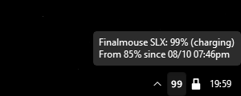
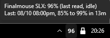

# SLX Finalmouse Battery Tray

A lightweight Windows tray monitor for Finalmouse SLX (Starlight X) battery status. It reads the mouse or receiver directly through native HID and displays a clean white battery percentage beside your clock, including live percentage updates while charging.

**Monitoring uses native HID only.** It polls every 10 seconds and saves charge history locally. When the number changes, a brief upward dissolve makes the new reading easy to notice. While charging, the number pulses from dark grey to white every 1.2 seconds. It stays solid white when charging stops. There is no background browser.

**This is the SLX version.** For Ultralight X, use [ULX Finalmouse Battery Tray](https://github.com/saintordevil/ulx-finalmouse-battery-tray). Each version selects its own hardware; SLX keeps its own charge history and settings.

The SLX percentage is the device's reported state of charge, matching Xpanel. It does not use the ULX voltage-to-percentage curve.

## Install

You need Windows 10/11, **64-bit Python 3.10 or newer**, and a compatible Finalmouse SLX (Starlight X) mouse and receiver. Python 3.11 is the tested version. Physical validation used a StarlightX Dongle (`361D:0300`) and StarlightX Mouse (`361D:0310`) on Windows 11. Other SLX USB IDs and firmware combinations are not claimed as tested.

1. Install [64-bit Python for Windows](https://www.python.org/downloads/windows/) if needed. Include the Python launcher or add Python to PATH.
2. [Download the project ZIP](https://github.com/saintordevil/slx-finalmouse-battery-tray/archive/refs/heads/master.zip) and extract the complete folder to a permanent location. You can also clone this repository.
3. Double-click **`install.bat`**. Wait for **Installation complete**. It creates a local `.venv` and installs Pillow, pystray, and hidapi. Internet access is needed for this step.
4. Connect the receiver, turn on the mouse, and double-click **`start.bat`**.
5. If the icon is hidden, open the tray's hidden-icons arrow and drag it beside your clock.

For a launch without a console flash, double-click **`finalmouse_tray_silent.vbs`**. The launchers need Windows Script Host, use the environment beside them, and work with different usernames and folder paths. The installer does not install Python or alter your global Python packages. Native monitoring needs no network connection.

### Start with Windows

Create a shortcut to `finalmouse_tray_silent.vbs`. Press **Win+R**, enter **`shell:startup`**, and place the shortcut there. Keep the app in its permanent folder. Remove the shortcut to disable automatic startup.

### Upgrade

Choose **Quit** from the tray menu, or run **`stop.bat`**. Copy the new project files over your existing installation, preserving `.venv`, then run **`install.bat`** and **`start.bat`** again. If updating a Git checkout, preserve any local changes.

Charge history lives in `%LOCALAPPDATA%\slx-finalmouse-battery-tray`, separate from the app folder. Keep that data folder during upgrades. When moving to another PC or folder, run the installer there instead of copying `.venv`.

## Use

Hover over the tray icon for charge details. Right-click for:

| Control | Action |
|---|---|
| **Refresh** | Reopens the receiver and requests a fresh reading |
| **Reconnect Receiver** | Reconnects the native reader and reads its status |
| **Charge details** | Shows current charging status and complete session details |
| **Quit** | Stops the app and releases the receiver |

Only one instance runs at a time. **`stop.bat`** also stops the app using the included PowerShell helper.

When the mouse sleeps, the tray keeps its last valid percentage and the tooltip marks it as `last read, idle`. It resumes fresh updates after the mouse wakes. The tray shows `--` before its first reading or when the receiver is missing or a query fails. It preserves saved history and retries automatically. Removing the receiver alone does not mean the mouse is charging. Wireless readings remain white; Windows' animation preference is respected.

### Live charging and charge history

Move the USB cable from the receiver to the mouse to charge. The white number continues to show the **live wired percentage**, and the tooltip identifies it as charging, for example `Finalmouse SLX: 74% (charging)`. The charging flag comes from the mouse itself. A USB connection alone is not treated as proof of charging.

The starting percentage stays fixed in the session history while the tray number updates. A fresh noncharging reading, either wired or wireless, finishes the session. If the mouse remains plugged in after charging stops, the tooltip labels the connection `(USB)`. Sessions without a known starting percentage or an increase are not saved as completed charges.

Unavailable readings keep a pending session open. Sleep retains the explicitly labeled last reading; missing receivers and query failures display `--`. Its duration includes any gap before a fresh noncharging reading arrives. The tooltip prioritizes the live reading and fits the Windows tooltip limit; **Charge details** keeps the full previous session readable. No estimated percentage or charge-time countdown is substituted for real readings.

## Screenshots

Live wired charging, with the percentage and session start in the tooltip.

The charging pulse, recorded from the running tray.

Wireless battery status, with the completed charge in the tooltip.

## Troubleshooting

| Symptom | Check |
|---|---|
| Python is not found | Install 64-bit Python 3.10+ with its launcher or PATH entry, then rerun `install.bat`. |
| Missing dependencies or launch files | Extract the complete project and run `install.bat` in that same folder. Check the installer's error if it fails. |
| Existing `.venv` is incompatible | The installer preserves it and stops. Repair it, or extract to a new folder and install there. |
| No tray icon | Check hidden tray icons, then inspect `%LOCALAPPDATA%\slx-finalmouse-battery-tray\tray.log`. |
| `--` or an unavailable reading | Connect the receiver, wake the mouse, and wait for a poll or choose **Refresh**. Close other software holding the receiver if reads keep failing. |
| Ambiguous devices | Use one supported mouse/receiver setup. Duplicate matching interfaces are rejected; multiple mice are not paired to receivers by this tool. |
| Charging status has not changed | Wait up to 10 seconds or choose **Refresh**. A pending session closes after a fresh noncharging reading. |

Your data folder contains `charge_log.json` and the bounded diagnostic `tray.log`. To back up history, quit the app and copy `charge_log.json`. Unchanged readings do not rewrite the history file or redraw the percentage icon.

## Further details

- [Release changes, measurements, and validation](CHANGELOG.md)
- [Development and tests](docs/DEVELOPMENT.md)

## License

[MIT](LICENSE)
